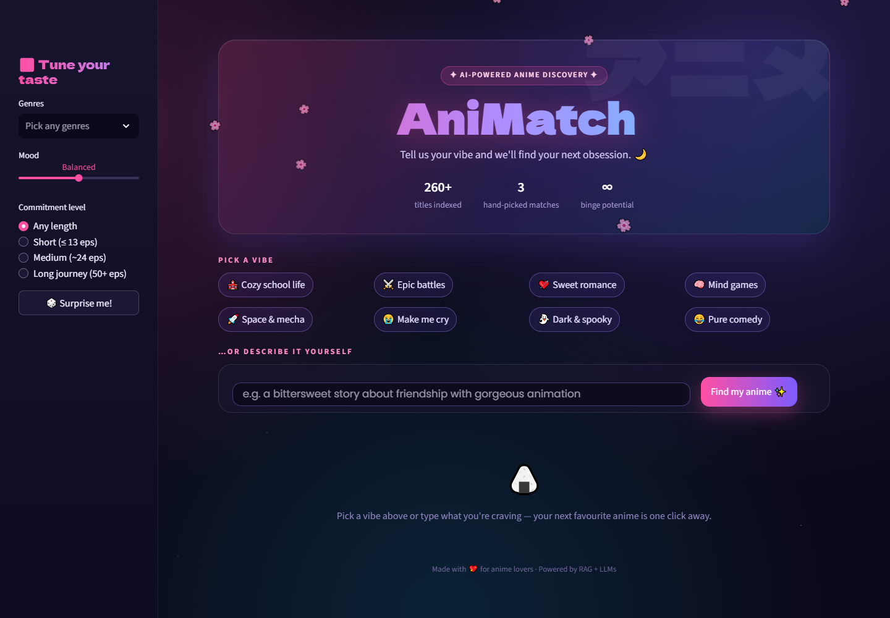
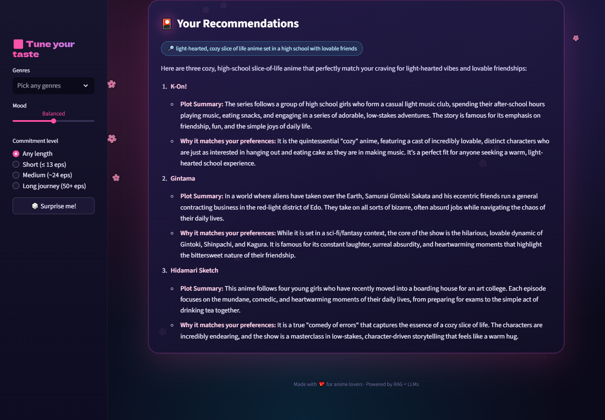
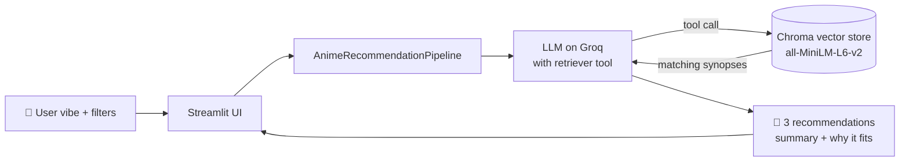

<div align="center">

# 🌸 AniMatch — AI Anime Recommender

**Tell it your vibe. It finds your next obsession.**

An LLM-powered anime recommender built on **RAG**: your request is matched against a vector database of anime synopses, and an LLM picks **three titles**, each with a plot summary and the reason it fits your taste.




</div>

---

## ✨ Features

| | |
|---|---|
| 🎴 **Three picks per search** | Each recommendation comes with a short plot summary and *why it matches you*. |
| ⚡ **One-click vibes** | Cozy school life, Epic battles, Sweet romance, Mind games, Space & mecha, Make me cry, Dark & spooky, Pure comedy. |
| 🎛️ **Tune your taste** | Sidebar filters for **genres**, **mood** (Wholesome → Dark) and **length** (short, medium, long) are added to your query. |
| 🎲 **Surprise me** | Random prompts for hidden gems, classics, weekend binges and more. |
| 🕘 **Search history** | Click a recent search to run it again. |
| 🧠 **RAG, not guesswork** | Answers are grounded in a Chroma vector store of anime titles, synopses and genres. |
| 🔁 **Retries** | Groq sometimes rejects a malformed tool call. The app retries twice and then asks you to try again instead of crashing. |
| 📊 **LLM-as-a-judge evaluation** | A LangSmith pipeline scores relevance and faithfulness against a golden dataset. |
| 🐳 **Deployable** | Comes with a Dockerfile and a Kubernetes manifest. |

## 📸 Screenshots

<div align="center">

**Pick a vibe → get handpicked recommendations**



</div>

## 🧩 How it works



1. **Data prep:** `AnimeDataLoader` merges each anime's *name*, *synopsis* and *genres* into one text field.
2. **Indexing:** `VectorStoreBuilder` embeds that text with HuggingFace `all-MiniLM-L6-v2` and saves it to `chroma_db/`.
3. **Retrieval + generation:** `AnimeRecommender` gives the LLM an `anime_retriever_tool`. The model searches the vector store, reads the matching synopses and writes its three picks.
4. **UI:** `app/app.py` combines your text with the sidebar filters and shows the answer in a styled card.

## 🛠️ Tech stack

- **Frontend:** Streamlit with a custom dark/neon anime theme
- **Orchestration:** LangChain (tool calling, prompt templates)
- **LLM:** Groq (`qwen/qwen3.8-27b` by default, set in `config/config.py`)
- **Vector DB:** ChromaDB
- **Embeddings:** Sentence-Transformers `all-MiniLM-L6-v2` via `langchain-huggingface`
- **Evaluation:** LangSmith
- **Deployment:** Docker and Kubernetes

## 📁 Project structure

```
anime-recommender/
├── app/
│   └── app.py                 # Streamlit UI (AniMatch)
├── config/
│   └── config.py              # API keys + model name
├── data/
│   ├── anime_with_synopsis.csv
│   ├── anime_updated.csv      # processed text that gets embedded
│   └── evaluation_test_cases.csv
├── pipeline/
│   ├── build_pipeline.py      # builds the Chroma vector store
│   └── pipeline.py            # recommendation pipeline used by the app
├── src/
│   ├── data_loader.py         # CSV cleaning + text merging
│   ├── vector_store.py        # embeddings + Chroma build/load
│   ├── recommender.py         # LLM + retriever tool + retries
│   ├── prompt_template.py     # recommender prompt
│   └── evaluation.py          # LangSmith LLM-as-a-judge evals
├── utils/                     # logger, custom exceptions
├── chroma_db/                 # prebuilt vector store
├── .streamlit/config.toml     # theme
├── Dockerfile
├── llmops-k8s.yaml            # Kubernetes Deployment + Service
├── requirements.txt
└── setup.py
```

## 🚀 Quick start

### 1. Clone and install

```bash
git clone https://github.com/GantaGourish/anime-recommender.git
```

```bash
cd anime-recommender
```

```bash
python -m venv venv
```

Activate it (`venv\Scripts\activate` on Windows, `source venv/bin/activate` on macOS/Linux), then:

```bash
pip install -e .
```

### 2. Add your API keys

Create a `.env` file in the project root:

```env
GROQ_API_KEY=your_groq_api_key
HF_TOKEN=your_huggingface_token

# Only needed for evaluation
LANGSMITH_API_KEY=your_langsmith_api_key
```

Get a free Groq key at [console.groq.com](https://console.groq.com) and a HuggingFace token at [huggingface.co/settings/tokens](https://huggingface.co/settings/tokens).

### 3. (Optional) Rebuild the vector store

A prebuilt `chroma_db/` is included. To rebuild it after changing the data:

```bash
python pipeline/build_pipeline.py
```

### 4. Run the app

```bash
streamlit run app/app.py
```

Open **http://localhost:8501** and pick a vibe! 🎉

> The first load takes a few seconds while the embedding model loads.

## 🐳 Docker

```bash
docker build -t llmops-app:latest .
```

```bash
docker run -p 8501:8501 --env-file .env llmops-app:latest
```

## ☸️ Kubernetes

The manifest runs one replica of `llmops-app:latest` behind a `LoadBalancer` service on port 80. It reads API keys from a secret named `llmops-secrets`.

```bash
kubectl create secret generic llmops-secrets --from-env-file=.env
```

```bash
kubectl apply -f llmops-k8s.yaml
```

```bash
kubectl get svc llmops-service
```

## 📊 Evaluation

`src/evaluation.py` uploads `data/evaluation_test_cases.csv` to LangSmith as the **"Anime Golden Dataset"** and runs every question through the pipeline. An LLM judge then scores:

- **Relevance:** does the answer match the user's intent and the reference answer?
- **Faithfulness:** does it stay consistent with the reference context (no hallucinations)?

```bash
python src/evaluation.py
```

Results show up in your LangSmith project under the `golden-ref-v1` experiment prefix.

## ⚙️ Configuration

| What | Where |
|---|---|
| LLM model | `MODEL_NAME` in `config/config.py` |
| Prompt and answer format | `src/prompt_template.py` |
| Embedding model / chunk size | `src/vector_store.py` |
| Retry count | `retries` in `AnimeRecommender.get_recommendation` (`src/recommender.py`) |
| Theme colours | `.streamlit/config.toml` and the CSS block in `app/app.py` |
| Vibe chips and Surprise-me prompts | `VIBES` and `SURPRISE_PROMPTS` in `app/app.py` |

## 🩹 Troubleshooting

- **"Our recommender tripped over a plot twist":** the LLM failed three times in a row (usually Groq rejecting a malformed tool call, or a temporary 503). Try again. Details are in `logs/`.
- **`ModuleNotFoundError: pipeline`:** run Streamlit from the project root, and run `pip install -e .`.
- **Empty or odd recommendations:** rebuild the vector store with `python pipeline/build_pipeline.py`.

## 🙌 Author

Built by [**Ganta Gourish**](https://github.com/GantaGourish). If you like it, leave a ⭐ on the repo!

<div align="center">

*Made with 💖 for anime lovers.*

</div>
